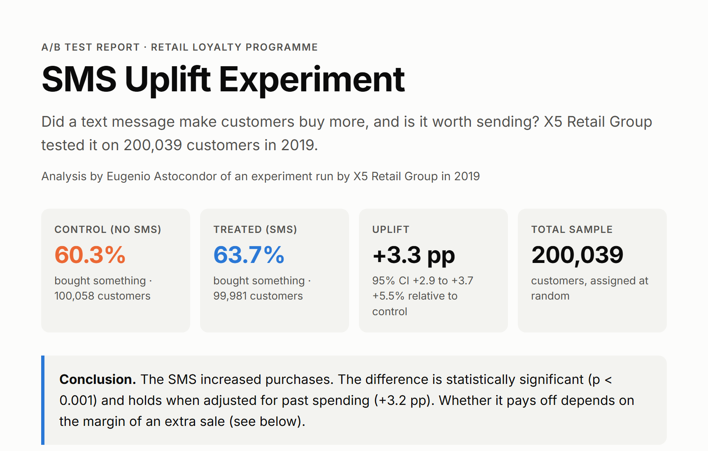

# Does an SMS campaign increase purchases? Designing, analysing and refining an A/B test

[](https://github.com/ast-e/sms-uplift-ab-testing/actions/workflows/tests.yml)

## At a glance

| | Purchase rate | Customers |
|---|---|---|
| Control (no SMS) | 60.3 % | 100,058 |
| Treated (SMS) | 63.7 % | 99,981 |
| **Uplift** | **+3.3 pp** (95 % CI +2.9 to +3.7) | 200,039 in total |

**The SMS works, but the effect is modest.** The experiment was valid (random assignment, balanced groups). The business report is a one-page summary of the result and the decision: **[read it online](https://ast-e.github.io/sms-uplift-ab-testing/reports/sms-uplift-experiment.html)**. The rest of this README is the detailed version.



## Summary

A large retailer (X5 Retail Group) sent an SMS to a random half of its loyalty-card holders and recorded who bought afterwards. In X5's experiment, customers who received the SMS bought at **63.7 %** versus **60.3 %** for those who did not: an increase of **+3.32 percentage points** (95 % confidence interval +2.90 to +3.75). Refining the estimate with each customer's purchase history from *before* the campaign (a technique called CUPED) gives **about +3.2 points** with a slightly narrower interval (+2.77 to +3.58), so the conclusion is the same: **the SMS works, but its effect is modest** and it only pays off if an extra purchase is worth at least about €1.50 in margin (hypothetical figure, under an assumed cost of €0.05 per SMS). I would roll it out to the customers who respond most, keep a small hold-out group, and confirm the targeting with a properly designed follow-up test.

**Who did what.** The experiment is **X5's**, run in 2019 and published for the RetailHero competition; I did not run it. I analysed the published results, and the test design in this project is a proposal for a *next* test that was never launched.

## The story, in the order of an experiment

| Step | What it answers | Where | Nature |
|---|---|---|---|
| 1. Design | How would I set up the next test? | `notebooks/01_experiment_design.ipynb` | Theory: nothing was run |
| 2. Execution | Run the test | X5, 2019 | Not part of this project |
| 3. Analysis | What happened in X5's experiment? | `notebooks/02_uplift_sms_analysis.ipynb` | Real results from a third party |
| 4. Refinement | Can the estimate be sharper? | `notebooks/03_cuped_variance_reduction.ipynb` | Same data, plus pre-campaign history |
| 5. Recommendation | What should be done? | this README, section 4 | Decision |

### 1. How I would design the next test (notebook 01)

Baseline and variance come from X5's control group (60.3 % of customers buy without any SMS), which is common practice when planning the next experiment from previous ones.

- **Minimum effect worth detecting: 1 percentage point.** It is derived from stated economic assumptions (€0.05 per SMS, €5 margin per incremental purchase; both hypothetical and editable in the notebook), not picked arbitrarily. A sensitivity table shows how it changes with the margin.
- **Sample size:** 37,570 customers per arm (75,140 in total), about 2 weeks if 40,000 customers could be enrolled per week (also an assumption).
- **Decision rule written in advance:** ship, iterate or stop, depending on where the confidence interval sits relative to the break-even effect and the guardrails.
- **Why not peek at the results early.** An A/A simulation (control customers only, so any "difference" is chance) shows that checking the test repeatedly inflates false positives: 5.3 % with one look, 15.2 % with 5 looks, 26.3 % with 20 looks, against the nominal 5 %. Fix the sample size and read the result once, or use sequential methods (noted as a future step, not implemented).
- **CUPED, in theory:** a table of the sample size saved for illustrative correlations of 0.3, 0.5 and 0.7, labelled as *not estimated from data*; the real value is measured in step 3.

### 2. What happened in X5's experiment (notebook 02)

- **The experiment was valid.** The split is 49.98 % treated, there is no sample-ratio mismatch (p = 0.86), all covariates are balanced (|SMD| < 0.1) and customer characteristics cannot predict who received the SMS (AUC 0.501).
- **Effect:** control 60.3 % vs treated 63.7 %, +3.32 points (95 % CI +2.90 to +3.75), a relative lift of 5.5 %.
- **Who responds** (exploratory, with Benjamini-Hochberg correction for 14 segment tests): the effect rises with age, from +1.3 points at 16-24 to +5.9 points at 65+, and is larger for recent customers (+4.6) than for the longest-standing (+2.3).
- **Is it worth it?** Break-even analysis with a hypothetical cost of €0.05 per SMS: the campaign pays back if an incremental purchase is worth at least **€1.50** of margin (€1.73 with the pessimistic end of the interval). By segment the bar moves from €0.85 (65+) to €3.73 (16-24).

### 3. Refinement with CUPED (notebook 03)

CUPED removes from each customer's outcome the part that could be predicted from their past behaviour. Here the covariate is the customer's spending history before the campaign (`log1p` of total spend, with the number of transactions as a robustness check). It does not bias the effect because the covariate is measured before the SMS.

| Estimate | Effect | 95 % CI | Interval width vs original |
|---|---|---|---|
| Original | +3.32 pp | +2.90 to +3.75 | 1.000 |
| CUPED, past spend (rho = 0.32) | +3.17 pp | +2.77 to +3.58 | 0.946 |
| CUPED, number of transactions (rho = 0.36) | +3.20 pp | +2.80 to +3.59 | 0.934 |

- **A modest gain, and an honest one.** Past behaviour predicts future behaviour only moderately (rho around 0.3-0.4), so the interval narrows by 5-7 %, exactly the `sqrt(1 - rho^2)` the theory predicts (the notebook asserts this).
- **The point estimate moves slightly, from +3.32 to about +3.2.** By chance, customers who received the SMS had a little more past spend (standardised difference 0.010), and CUPED corrects for it; the shift equals `-theta` times that imbalance (checked in the notebook).
- **Back to the design:** with the real rho, the 1-point design above needs 33,627 customers per arm instead of 37,570, a saving of 10.5 %. That is at the low end of the illustrative range in notebook 01, so I would plan with a modest saving.
- **Pre-campaign check.** The source states that the purchase file is history before the campaign. As an additional check, the share of customers with a purchase after the latest card issue date (2019-03-15) is the same in both arms (38.02 % vs 38.03 %, p = 0.95), which is consistent with a clean history. It is evidence, not proof: the real campaign date is not published.

### 4. Recommendation

All economic figures below are **hypothetical** (the data has no spend, margin or cost information; the assumptions are editable in notebook 02).

1. **Send the SMS if an extra purchase is worth at least about €1.50 of margin** (assuming €0.05 per message). If the retailer's real margin is below that, the campaign does not pay back on average.
2. **Prioritise the customers who respond most.** The break-even bar is lowest for customers aged 65+ (€0.85) and highest for 16-24 (€3.73); for the weakest segments, check that it pays back before sending.
3. **Confirm the targeting in a follow-up experiment** designed as in section 1: fixed sample size, one reading, guardrail metrics (basket value, opt-outs) and CUPED planned from the start. The segment results here are exploratory.
4. **Keep a small hold-out group** so the effect can be tracked over time rather than assumed.

## Limitations

- No spend, margin or churn data: the economics are hypothetical.
- High baseline (about 60 % buy without the SMS): there is little room to move the metric, and part of the effect could be purchases brought forward rather than new demand.
- The campaign date, the outcome window and the intended allocation ratio are not documented. Randomisation is supported by the balance checks, not by documentation.
- No guardrail metrics are observed (unsubscribes, complaints, long-term retention).
- Segment results are exploratory and still need confirmation.
- Data from a Russian food retailer in 2019: the logic transfers, the figures do not.
- No machine-learning uplift models: customer-level targeting is a possible next step.

## Data

Source: X5 Retail Group, *RetailHero uplift modelling* competition (2019), https://ods.ai/competitions/x5-retailhero-uplift-modeling. Copy used: the Hugging Face dataset `pytorch-lifestream/retailhero-uplift` (the older name `dllllb/retailhero-uplift` redirects to it), which links back to the competition page; neither page states permission from X5 for the copy. **No licence is stated** on either the competition page or the Hugging Face page, so **the data is not included in this repository** and `data_raw/` is git-ignored. Please cite X5 and the competition if you reuse it.

Download these files from the Hugging Face dataset into a `data_raw/` folder at the root of the project:

| File (in `data/` on Hugging Face) | Used for | Size |
|---|---|---|
| `clients.csv.gz` | customer attributes | ~8 MB |
| `uplift_train.csv.gz` | treatment flag and outcome | ~1 MB |
| `purchases.csv.gz` | purchase history, to build the CUPED covariates | ~0.6 GB (45.8 M lines) |

`purchases.csv.gz` is only needed for notebook 03. Turn it into per-customer features with `python scripts/build_purchase_features.py`, run from the project root (it writes `data_raw/purchases_features.csv.gz`; it took about 12 minutes on my machine).

## Reproduce

All commands are run from the project root.

```bash
# 1. Create an environment and install the dependencies (tested with Python 3.15.2)
python -m venv .venv
.venv\Scripts\activate                  # Windows. On macOS/Linux: source .venv/bin/activate
pip install -r requirements.txt

# 2. Check that the statistics helpers work (19 tests)
pytest

# 3. Download the data into data_raw/ (see the Data section), then build the features for notebook 03
python scripts/build_purchase_features.py

# 4. Open the notebooks in order, or run one from the terminal
jupyter notebook notebooks/
jupyter nbconvert --to notebook --execute --inplace notebooks/01_experiment_design.ipynb
```

Notebooks 01 and 02 only need `clients.csv.gz` and `uplift_train.csv.gz`. Each notebook opens with a "Role of this notebook" cell and, if a data file is missing, stops with a message saying which file to download.

## Project structure

```
.
├── notebooks/               the analysis, in the order of an experiment
│   ├── 01_experiment_design.ipynb
│   ├── 02_uplift_sms_analysis.ipynb
│   └── 03_cuped_variance_reduction.ipynb
├── src/ab_utils.py          tested helpers: sample size, minimum detectable effect, A/A simulation
│                            with peeking, difference in means, CUPED, attaching purchase history
├── scripts/build_purchase_features.py   per-customer pre-campaign features from the purchase file
├── tests/test_ab_utils.py   unit tests for the helpers
├── reports/                 the business report (self-contained HTML) and its preview image
├── data_raw/                downloaded data, not tracked (see the Data section)
├── requirements.txt
└── LICENSE
```

## Licence

The code is released under the MIT licence (see `LICENSE`). The data belongs to X5 Retail Group and is not covered by it.
